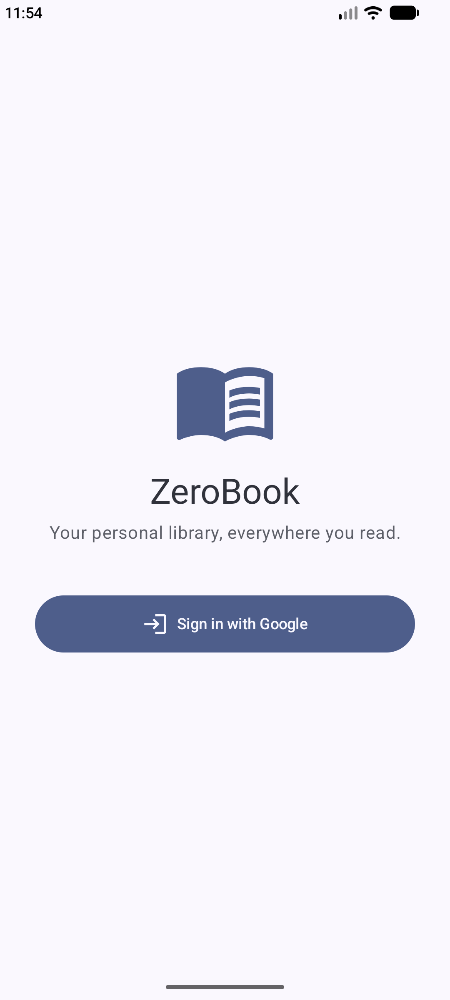
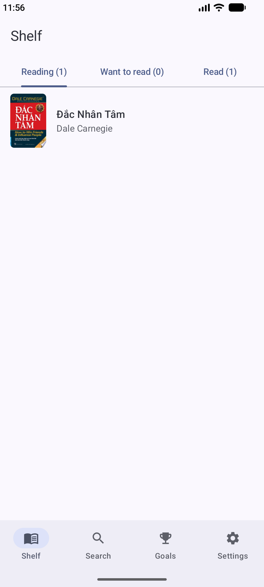
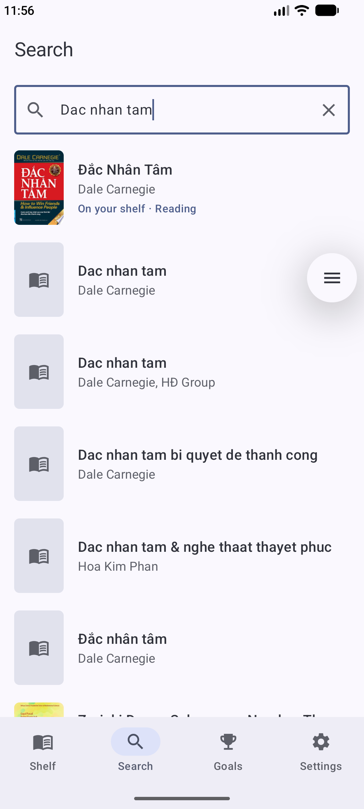
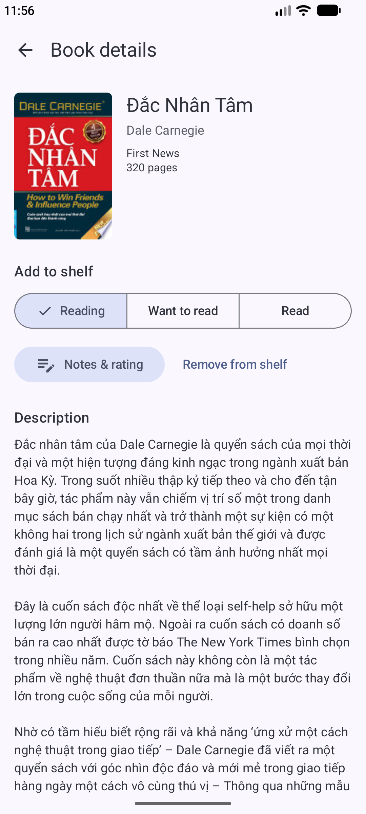
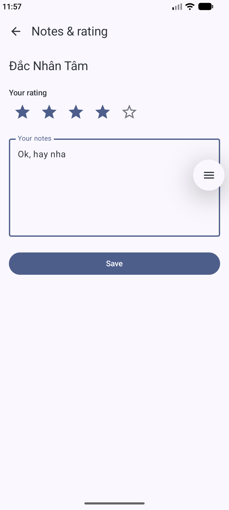
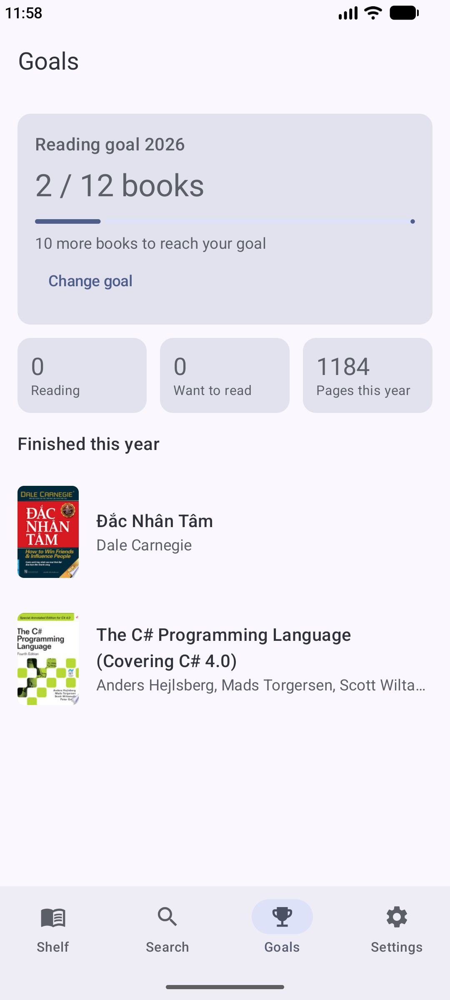
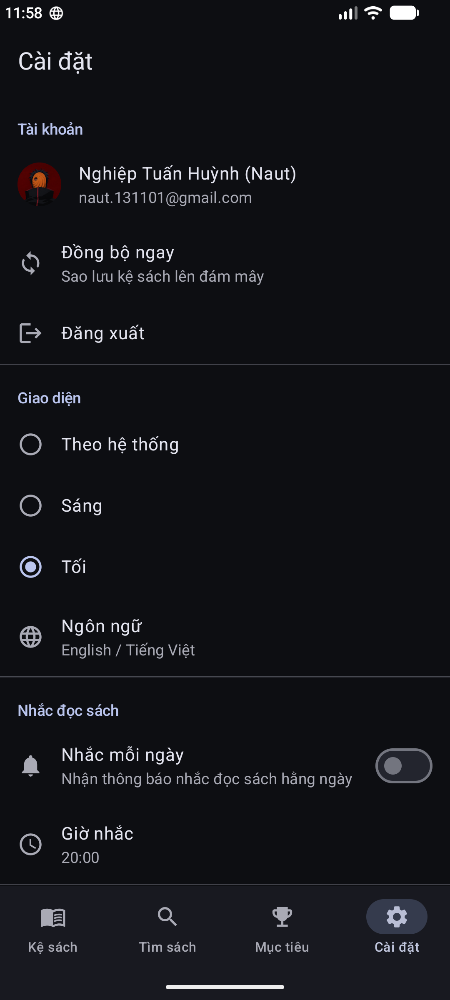

# ZeroBook — Thư viện sách cá nhân

Ứng dụng Android giúp người thích đọc sách quản lý sách của mình: tìm sách, xếp lên kệ theo trạng thái **Đang đọc / Muốn đọc / Đã đọc**, ghi chú và đánh giá, đặt mục tiêu đọc trong năm và nhận nhắc nhở đọc sách mỗi ngày. Dữ liệu dùng được khi offline và tự đồng bộ giữa các máy qua tài khoản Google.

> Đồ án cuối khoá Kotlin/Android — thực hiện cá nhân.

## Ảnh chụp màn hình

<!-- TODO: thêm ảnh chụp 7 màn hình vào thư mục docs/screenshots và cập nhật bảng dưới -->

| Đăng nhập | Kệ sách | Tìm sách | Chi tiết |
|---|---|---|---|
|  |  |  |  |

| Ghi chú & đánh giá | Mục tiêu | Cài đặt |
|---|---|---|
|  |  |  |

## Tính năng

| Màn hình | Chức năng |
|---|---|
| Đăng nhập | Đăng nhập Google qua Firebase Auth + Credential Manager |
| Kệ sách | 3 tab theo trạng thái (kèm số lượng), hiển thị đánh giá sao |
| Tìm sách | Tìm theo tên/tác giả/ISBN qua Google Books API, đánh dấu sách đã có trên kệ |
| Chi tiết sách | Thông tin, mô tả, chọn trạng thái, xoá khỏi kệ; xem được offline nếu sách đã trên kệ |
| Ghi chú & đánh giá | Chấm 1–5 sao, viết ghi chú |
| Mục tiêu | Mục tiêu số sách/năm, thanh tiến độ, thống kê, danh sách sách đã đọc trong năm |
| Cài đặt | Tài khoản, đồng bộ, theme Sáng/Tối/Theo hệ thống, ngôn ngữ, giờ nhắc đọc sách, đăng xuất |

Ngoài ra: Dynamic Color (Android 12+), song ngữ Tiếng Việt / English, trạng thái loading / empty / error ở mọi màn có dữ liệu.

## Công nghệ

- **UI:** Jetpack Compose + Material 3 (100% Compose), Navigation Compose với route type-safe
- **Kiến trúc:** MVVM — ViewModel + StateFlow, Repository; DI bằng Hilt
- **Dữ liệu từ xa:** Google Books API (Retrofit + kotlinx.serialization), Cloud Firestore
- **Offline:** Room là nguồn dữ liệu chính (single source of truth); DataStore cho cài đặt
- **Nền tảng:** WorkManager (đồng bộ nền + nhắc đọc hằng ngày), local notification, runtime permission `POST_NOTIFICATIONS`
- **Khác:** Coil (ảnh bìa), Credential Manager (Google Sign-In)

## Kiến trúc

```
UI (Compose Screen) ──event──▶ ViewModel ──▶ Repository ──▶ Room (local)
        ▲                          │               │
        └──── StateFlow<UiState> ──┘               ├──▶ Google Books API (Retrofit)
                                                   └──▶ Firestore (qua SyncWorker)
```

**Luồng offline-first của kệ sách:**
1. Mọi thay đổi được ghi vào Room trước và đánh dấu `pendingSync = true` → UI cập nhật ngay kể cả khi mất mạng.
2. Repository xếp lịch `SyncWorker` (WorkManager, yêu cầu có mạng, tự thử lại với backoff).
3. `SyncWorker` đẩy các thay đổi lên Firestore tại `users/{uid}/books/{bookId}`, sau đó kéo dữ liệu từ máy khác về. Xung đột được giải quyết theo `updatedAt` (bản sửa sau thắng; thay đổi chưa đồng bộ ở máy hiện tại luôn được giữ).
4. Xoá sách là "xoá mềm" (`isDeleted`) cho tới khi Firestore xác nhận đã xoá.

**Cấu trúc package:**

```
com.example.zerobook
├── model/        Model của app (Book, ShelfBook, ReadingStatus, ...)
├── data/
│   ├── local/    Room: Entity, DAO, Database
│   ├── remote/   Retrofit API + DTO, Firestore data source
│   ├── repository/  Interface + bản cài đặt repository
│   └── util/
├── di/           Hilt modules
├── work/         SyncWorker, ReminderWorker, ReminderScheduler, notification channel
└── ui/           Mỗi màn một package: Screen (stateful) + Content (stateless) + ViewModel
```

## Cài đặt & chạy

1. Clone repo, mở bằng Android Studio (bản mới, hỗ trợ AGP 9).
2. Tạo project Firebase, thêm app Android với package `com.example.zerobook` và SHA-1 debug (`./gradlew signingReport`).
3. Tải `google-services.json` đặt vào thư mục `app/`.
4. Firebase Console → Authentication → bật **Google**. Copy **Web client ID** và dán vào `app/src/main/res/values/strings.xml` ở dòng `google_web_client_id`.
5. Tạo Firestore Database, rồi dán nội dung file [`firestore.rules`](firestore.rules) vào tab **Rules** và bấm **Publish**.
6. Run.

## Kiểm thử

```bash
./gradlew testDebugUnitTest          # unit test ViewModel (JVM)
./gradlew connectedDebugAndroidTest  # Compose UI test (cần emulator đang chạy)
```

- Unit test: `ShelfViewModelTest`, `SearchViewModelTest`, `GoalsViewModelTest`, `LoginViewModelTest` — dùng repository giả (fake) trong `test/.../fakes`.
- UI test: `ShelfContentTest` — kiểm tra empty state và thao tác bấm sách trên màn Kệ sách.

## Bản release

<!-- TODO: cập nhật sau khi làm bước build release -->
- Ký bằng keystore riêng (không đưa keystore lên repo, xem `.gitignore`).
- Bật R8.
- Kích thước APK trước/sau R8: _cập nhật sau_.

## Tham khảo

- [Android Developers — Jetpack Compose, Navigation, Room, WorkManager, Hilt](https://developer.android.com)
- [Firebase Documentation — Authentication, Cloud Firestore](https://firebase.google.com/docs)
- [Google Books API](https://developers.google.com/books)
- **Công cụ AI:** dự án có sử dụng Claude (Anthropic) để hỗ trợ cấu hình Gradle, gợi ý kiến trúc và sinh một phần mã nguồn. Toàn bộ mã đã được đọc, chạy thử và chỉnh sửa; tác giả hiểu và có thể giải thích mọi phần trong dự án.
