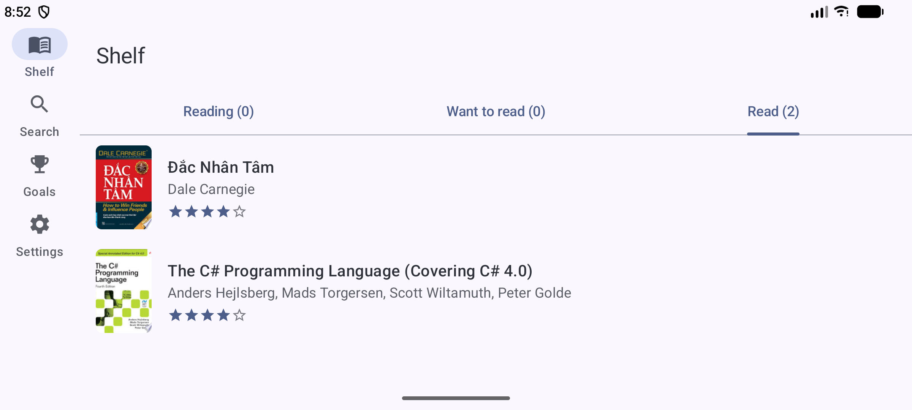
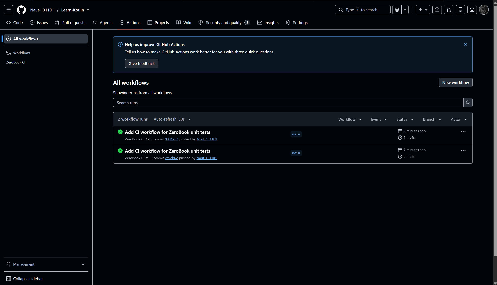
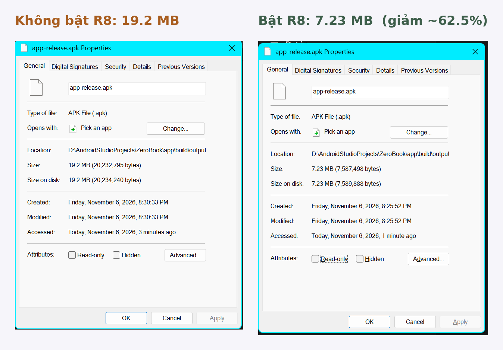

# ZeroBook 📚

ZeroBook là app Android quản lý tủ sách cá nhân mà em làm cho đồ án cuối khoá Kotlin/Android. App giúp mình theo dõi những cuốn sách đang đọc, đã đọc và muốn đọc, ghi lại cảm nhận, chấm điểm từng cuốn và đặt mục tiêu đọc bao nhiêu cuốn trong năm. Dữ liệu vẫn xem được khi không có mạng và tự đồng bộ lên cloud theo tài khoản Google, nên đổi máy vẫn còn nguyên kệ sách.

## Ảnh chụp màn hình

| Đăng nhập | Kệ sách | Tìm sách | Chi tiết |
|---|---|---|---|
|  |  |  |  |

| Ghi chú & đánh giá | Mục tiêu | Cài đặt |
|---|---|---|
|  |  |  |

**Màn hình lớn / xoay ngang:** thanh điều hướng chuyển sang bên trái (NavigationRail).



## Chức năng chính

- **Đăng nhập bằng Google** (Firebase Auth + Credential Manager).
- **Kệ sách** chia 3 tab: Đang đọc / Muốn đọc / Đã đọc, có hiện số lượng sách mỗi tab.
- **Tìm sách** theo tên, tác giả hoặc ISBN bằng Google Books API. Sách nào đã có trên kệ thì được đánh dấu luôn trong kết quả.
- **Chi tiết sách**: xem thông tin, giới thiệu, đổi trạng thái hoặc xoá khỏi kệ. Sách đã lưu thì mở được cả khi offline.
- **Ghi chú & đánh giá** từ 1 đến 5 sao cho từng cuốn.
- **Mục tiêu đọc trong năm**: thanh tiến độ, số trang đã đọc, danh sách sách đã đọc xong trong năm.
- **Cài đặt**: giao diện Sáng / Tối / Theo hệ thống, chọn ngôn ngữ, bật nhắc đọc sách mỗi ngày theo giờ tự chọn, đồng bộ thủ công, đăng xuất.
- Hỗ trợ **Tiếng Việt và English**, màu giao diện theo hình nền máy (Dynamic Color, Android 12+).
- **Animation** khi chuyển màn hình, thanh điều hướng ẩn/hiện mượt, thanh tiến độ mục tiêu chạy dần.
- **Màn hình lớn**: trên tablet hoặc khi xoay ngang, thanh điều hướng dưới chuyển thành thanh bên trái (NavigationRail).

## Công nghệ sử dụng

| Phần | Công nghệ |
|---|---|
| Giao diện | Jetpack Compose, Material 3 |
| Điều hướng | Navigation Compose (type-safe routes) |
| Kiến trúc | MVVM: ViewModel + StateFlow, Repository |
| Dependency Injection | Hilt |
| Gọi API | Retrofit, OkHttp, kotlinx.serialization |
| Lưu trữ offline | Room, DataStore |
| Cloud | Firebase Authentication, Cloud Firestore |
| Chạy nền | WorkManager (đồng bộ dữ liệu, nhắc đọc sách), Notification |
| CI | GitHub Actions (tự chạy unit test) |
| Ảnh | Coil |
| Kiểm thử | JUnit, kotlinx-coroutines-test, Compose UI Test |

## Kiến trúc

```
Compose Screen ──(sự kiện)──▶ ViewModel ──▶ Repository ──▶ Room
      ▲                           │              │
      └────── StateFlow ──────────┘              ├──▶ Google Books API
                                                 └──▶ Firestore (qua SyncWorker)
```

Em chọn hướng **offline-first**: Room là nơi lưu dữ liệu chính, giao diện chỉ đọc dữ liệu từ Room.

1. Khi người dùng thêm, sửa hoặc xoá sách, dữ liệu được ghi vào Room trước và đánh dấu `pendingSync = true`. Nhờ vậy giao diện cập nhật ngay, kể cả lúc mất mạng.
2. Repository gửi yêu cầu cho `SyncWorker`. WorkManager chỉ chạy worker khi có mạng và tự thử lại nếu bị lỗi.
3. `SyncWorker` đẩy các thay đổi lên Firestore (`users/{uid}/books/{bookId}`), sau đó tải dữ liệu từ máy khác về. Nếu hai máy cùng sửa một cuốn thì bản có `updatedAt` mới hơn sẽ được giữ lại.
4. Khi xoá sách, app chỉ đánh dấu `isDeleted` trước, đợi Firestore xoá xong mới xoá hẳn ở máy, để không bị mất đồng bộ.

Firestore có Security Rules (file [`firestore.rules`](firestore.rules)): mỗi người chỉ đọc và ghi được dữ liệu của chính mình, và dữ liệu được kiểm tra hợp lệ (status, rating 0–5, …) trước khi lưu.

### Cấu trúc thư mục

```
app/src/main/java/com/example/zerobook
├── model/         Các model: Book, ShelfBook, ReadingStatus, ...
├── data/
│   ├── local/     Room (Entity, DAO, Database)
│   ├── remote/    Retrofit API, DTO, Firestore
│   └── repository/
├── di/            Các Hilt module
├── work/          SyncWorker, ReminderWorker, lập lịch nhắc nhở
└── ui/            Mỗi màn hình một package (Screen + ViewModel)
```

## Hướng dẫn chạy project

**Yêu cầu:** Android Studio bản mới (hỗ trợ AGP 9), máy ảo hoặc máy thật từ Android 8.0 (API 26) trở lên.

1. Clone repo và mở thư mục `ZeroBook` bằng Android Studio.
2. **Firebase**
   - Tạo project trên Firebase, thêm app Android với package `com.example.zerobook` và SHA-1 (lấy bằng lệnh `./gradlew signingReport`).
   - Tải `google-services.json` rồi bỏ vào thư mục `app/`.
   - Vào Authentication → bật đăng nhập bằng **Google**.
   - Tạo Firestore Database, sau đó dán nội dung file `firestore.rules` vào tab Rules rồi bấm Publish.
3. **Web client ID**: lấy ở Authentication → Google → Web SDK configuration, dán vào `app/src/main/res/values/strings.xml` tại dòng `google_web_client_id`.
4. **Google Books API key**: tạo API key trên Google Cloud Console (giới hạn chỉ cho Books API), rồi thêm vào file `local.properties` ở thư mục gốc:
   ```properties
   GOOGLE_BOOKS_API_KEY=your_api_key
   ```
   Nếu không có key, app vẫn chạy nhưng Google Books hay báo lỗi 429 (quá nhiều request).
5. Bấm Run.

## Kiểm thử

```bash
./gradlew testDebugUnitTest          # Unit test cho ViewModel
./gradlew connectedDebugAndroidTest  # UI test, cần mở máy ảo trước
```

- **Unit test** (`app/src/test`): `ShelfViewModelTest`, `SearchViewModelTest`, `GoalsViewModelTest`, `LoginViewModelTest`. Các test dùng repository giả (fake) nên chạy trên JVM, không cần mạng hay Firebase.
- **UI test** (`app/src/androidTest`): `ShelfContentTest` kiểm tra trạng thái kệ trống và thao tác bấm vào sách.

| Unit test | UI test |
|---|---|
|  |  |

### Tự động chạy test với GitHub Actions

Mỗi khi có thay đổi trong thư mục `ZeroBook/` hoặc có pull request, GitHub Actions tự chạy toàn bộ unit test (workflow `.github/workflows/zerobook-ci.yml` ở gốc repo). Báo cáo test được lưu lại thành artifact của mỗi lần chạy.



## Bản release

- File APK đã ký nằm ở mục **Releases** của repo.
- App được ký bằng keystore riêng. Thông tin keystore để trong `keystore.properties`, không đưa lên GitHub.
- Đã bật R8 cho bản release, và thêm keep rule cho Credential Manager trong `app/src/main/keepRules/rules.keep` để đăng nhập Google không bị lỗi sau khi R8 tối ưu.
- Kích thước APK trước và sau khi bật R8 (cùng mã nguồn, build bằng `./gradlew assembleRelease`):

  | Bản release | Kích thước APK |
  |---|---|
  | Không bật R8 | 19.2 MB (20,232,795 bytes) |
  | Bật R8 | 7.23 MB (7,587,498 bytes) |
  | **Giảm** | **12.0 MB (~62.5%)** |

  Phần giảm chủ yếu đến từ việc R8 loại bỏ code không dùng trong các thư viện, nhất là bộ `material-icons-extended` (app chỉ dùng vài chục icon trong hàng nghìn icon của thư viện).

  
- SHA-1 của cả bản debug lẫn bản release đều đã khai báo trên Firebase, nên đăng nhập Google chạy được ở cả hai bản.

Muốn tự build bản release thì tạo file `keystore.properties` ở thư mục gốc:

```properties
storeFile=đường/dẫn/tới/file.jks
storePassword=...
keyAlias=...
keyPassword=...
```

rồi chạy `./gradlew assembleRelease`.

**Lưu ý về bảo mật:** API key Google Books không có trong source code (lấy từ `local.properties`) nhưng vẫn nằm trong file APK, vì app gọi API trực tiếp. Để hạn chế rủi ro, key đã được giới hạn chỉ dùng được cho Books API.

## Tham khảo

- [Tài liệu Android Developers](https://developer.android.com): Compose, Navigation, Room, WorkManager, Hilt
- [Tài liệu Firebase](https://firebase.google.com/docs): Authentication, Cloud Firestore
- [Google Books API](https://developers.google.com/books)
- Code mẫu từ các bài lab trong khoá học
- Có sử dụng Claude (AI) để hỗ trợ cấu hình Gradle, gợi ý cách tổ chức kiến trúc và viết một phần code; em đã đọc hiểu, chạy thử và chỉnh sửa lại toàn bộ.

## Tác giả

**Huỳnh Nghiệp Tuấn** · GitHub: [@Naut-131101](https://github.com/Naut-131101)
